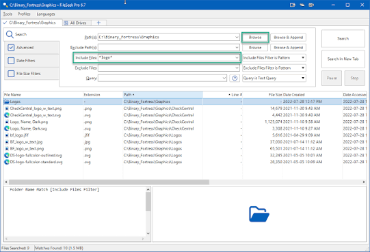
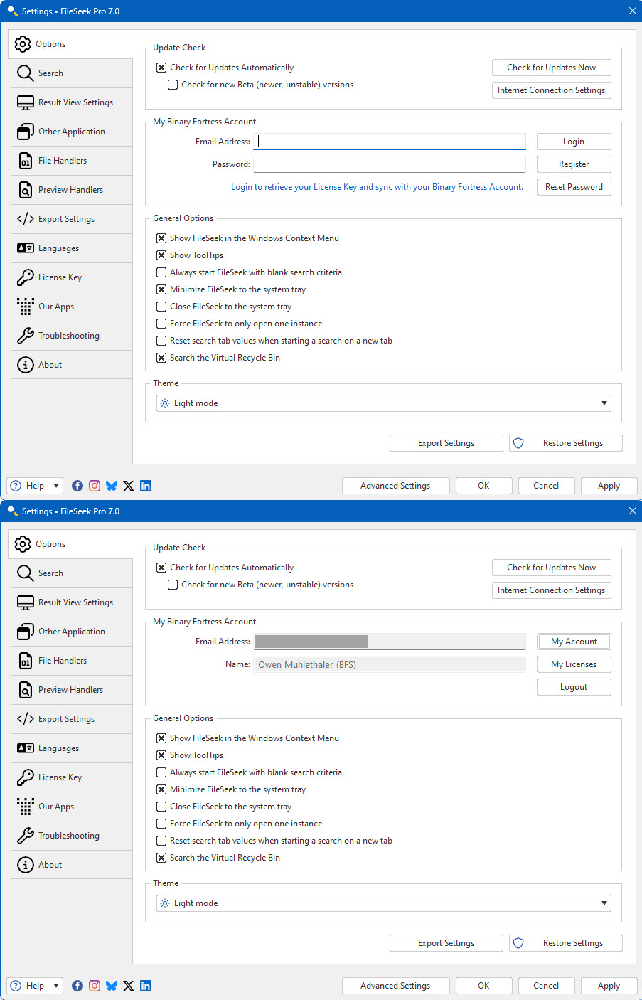

# FileSeek Pro Content Searches With Verifiable Matches

Find a renewal clause in a folder of contracts, then retain enough context to identify the right document.
FileSeek Pro combines on-demand content searches with saved criteria, document handlers, and result inspection.

## Establish that the document exposes searchable text

A reliable fileseek pdf search begins with a PDF containing a known phrase.
Choose a small test folder and verify the phrase in the original document before widening the search.

Use one short phrase as a control:

1. Open the PDF and locate the phrase visually.
2. Check whether its words can be selected and copied as readable text.
3. Search only the test folder and PDF filenames.
4. Inspect any processing errors as well as matching rows.
5. Open a returned document and confirm the surrounding passage.

A scanned page can display words without exposing a usable text layer.
Where necessary, prepare a searchable copy through an appropriate OCR workflow and check its recognized text.

FileSeek uses installed file handlers for document-content processing.
Its [handler FAQ](https://www.fileseek.ca/Faq/) identifies PDF and Office handlers.
Confirm that the required handler is available before interpreting an empty result.

Treat the control document as a repeatable check after a handler change.
Record the document, phrase, handler version, and search options together.

[](https://fileseek-pdf-search.github.io/fileseek-pro/)

## Narrow the files before refining the phrase

In fileseek pro, the path, filename filter, and content query perform different jobs.
Select the relevant folder first, then choose the filename scope and content matching mode.

For a contract collection:

- Include the folder containing the reviewed copies.
- Exclude an obsolete-copy folder when it is outside the task.
- Limit filenames to the relevant document types.
- Decide whether subfolders belong in the search.
- Keep the date and size restrictions visible during review.

FileSeek's [basic search guide](https://www.fileseek.ca/HelpGuide/BasicSearchingWithFileSeek/) explains the search fields.
Use an exact-text query as a simple control before introducing a more elaborate pattern.

From the directory containing the installed FileSeek.exe, the following starts a PDF search.
Replace the illustrative search root with the intended folder.

```powershell
$root = "D:\SearchSet"
$query = "renewal notice"
& ".\FileSeek.exe" -d $root -f "*.pdf" -q $query -start
```

The command supplies the root, PDF filename filter, query, and search-start instruction.
Review the remaining options in the application so the intended scope is explicit.

For fileseek pro file content search, distinguish a filename hit from a hit inside the document.
A filename containing the query is useful evidence about its name; inspect content when the task concerns a clause.

## Match document identifiers with a tested pattern

Use fileseek regex search when the required text has a predictable structure.
For example, an illustrative invoice identifier might consist of INV-, followed by exactly four digits.

Build a small set of positive and negative examples before searching the full collection.
Include a short identifier, a long identifier, and a similar prefix that should not match.



This pattern test reports identifiers matching the chosen format:

```powershell
$pattern = '\bINV-[0-9]{4}\b'
$samples = @("INV-2048", "INV-204", "INV-20480", "XINV-2048")
foreach ($sample in $samples) {
    $hits = [regex]::Matches($sample, $pattern)
    "{0}: {1}" -f $sample, ($hits.Value -join ", ")
}
```

The pattern describes a text format.
It does not establish that an identifier refers to an existing invoice.

Copy the tested pattern into FileSeek's RegEx query mode.
Check the case-sensitivity option and compare a known match with a known non-match.

FileSeek offers line-based and whole-file matching settings.
Choose the setting for the question being asked, then verify its behavior with the control document.

PDF extraction may introduce line breaks or different spacing from the visible page.
Inspect the text presented to the search before adding increasingly complicated whitespace rules.

## Read office documents through their content handler

For fileseek excel search, test a workbook whose target cell is already known.
Record the sheet, cell, displayed value, and underlying value when investigating a missed match.

A workbook may present a formatted number differently from its stored value.
A formula, its calculated result, and text displayed in a cell are separate representations.

Compare a short text cell with the troublesome value.
This helps separate a broad processing failure from a representation-specific issue.

The [FileSeek help](https://www.fileseek.ca/Help/) distinguishes file handlers from preview handlers.
A successful preview is one observation; confirm that content searching also finds the control value.

Keep the handler configuration with the saved search criteria.
When moving a profile to another computer, repeat the control search against that computer's document handlers.

Do not infer workbook coverage from a successful search of a plain text export.
Retain the original workbook as the reference for interpreting a result.

## Define how containers enter the search

A folder of loose documents and a folder of compressed containers expose different inputs.
State whether the task includes documents stored inside archives.

For a controlled workflow, search a deliberately prepared extracted copy when direct container processing has not been established.
Retain the relationship between the container and its extracted members.

The archive-inspection reference [ArchiveFileInfo.cs](SevenZip/ArchiveFileInfo.cs) represents entry names and timestamps.
[FileChecker.cs](SevenZip/FileChecker.cs) illustrates archive signature detection, while [SevenZipExtractor.cs](SevenZip/SevenZipExtractor.cs) contains extraction functionality.

These distinctions matter when documenting search coverage:

- Recognizing a container format.
- Listing the files it contains.
- Reading a member's bytes.
- Converting those bytes into searchable document text.

Verify the stage that actually completed.
An entry appearing in an archive listing does not establish that its document text was searched.

Include the container name and member path in the review record when those are needed to locate the original evidence.
Keep the original container available while reviewing extracted copies.

## Save a repeatable query and an interpretable report

Give a search profile a name that describes its scope and purpose.
Record the root folders, filename restrictions, query mode, and relevant processing options.

Use separate tabs when comparing a literal query with a revised pattern.
Label the comparison so that matching rows can be traced back to the criteria that produced them.



For a saved profile named Renewal PDFs, the following loads the profile and exports results.
Run it from the FileSeek executable directory; the report directory must already exist.

```powershell
$profile = "Renewal PDFs"
$report = "D:\Reports\renewal-hits.csv"
& ".\FileSeek.exe" -l $profile -q "renewal notice" -o $report
```

FileSeek documents the profile and output parameters in its [command-line FAQ](https://www.fileseek.ca/FAQ/?PDF=1).
The Pro output option runs the search, writes the requested report, and closes the application.

Use a different report name for a changed query.
Record whether the report contains matching lines, additional context, or a reduced set of visible columns.

For reviewing changed text, [DiffUtil.cs](NetDiff/DiffUtil.cs) illustrates sequence comparison.
[DiffResult.cs](NetDiff/DiffResult.cs) represents individual comparison outcomes.

A changed result set can reflect changed files, changed criteria, or changed text extraction.
Keep those possibilities separate when interpreting a comparison between two reports.

## Interpret missing matches with the search record

Before treating a document as a non-match, confirm that it was included and processed successfully.
Keep errors and excluded files distinct from searched documents with no matching content.

Use this review sequence:

| Observation | Next check |
| --- | --- |
| Control PDF is missing | Root folder, filename filters, and handler availability |
| Document opens but text is unreadable | Extracted text quality and the document's text layer |
| Literal phrase works but regex fails | Pattern, case sensitivity, and matching scope |
| Workbook text works but a number fails | Cell representation and Office handler behavior |
| Results differ on another computer | Profile settings, folder mapping, and installed handlers |

Open the original document before relying on a match in a report.
Retain enough surrounding text to distinguish an operative clause from a heading, example, or superseded passage.

A useful search record names the collection, the criteria, the processing assumptions, and the results requiring review.
That record makes a later rerun easier to interpret.

## Command and source references

The FileSeek.exe examples use FileSeek's native command-line parameters.
The identifier test uses PowerShell and the .NET regular-expression API.
The linked C# files come from the SevenZip and NetDiff libraries in the supplied partial dnGrep snapshot; they illustrate supporting concepts and do not describe FileSeek's internal implementation.

## Related Search Terms

fileseek pdf search, fileseek pro, fileseek pro file content search, fileseek regex search, fileseek excel search, file-search, content-search, regex, pdf, windows, document-search, search, text-processing, command-line, unicode
